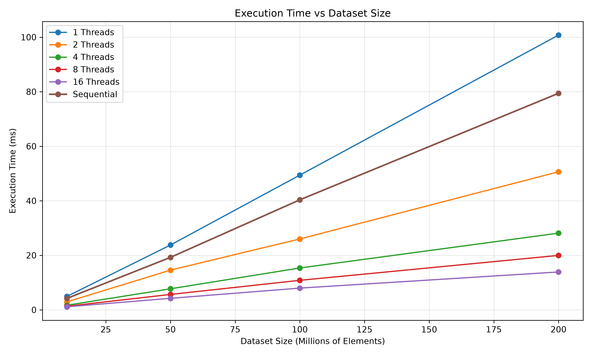
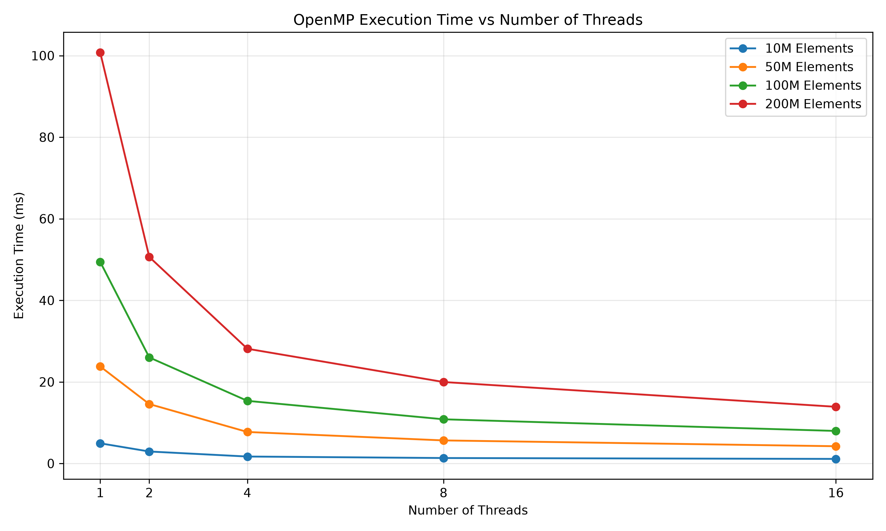
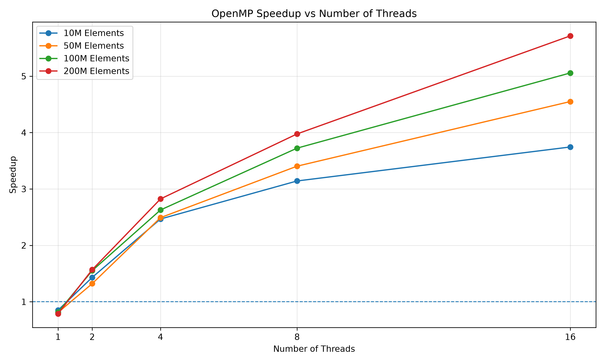
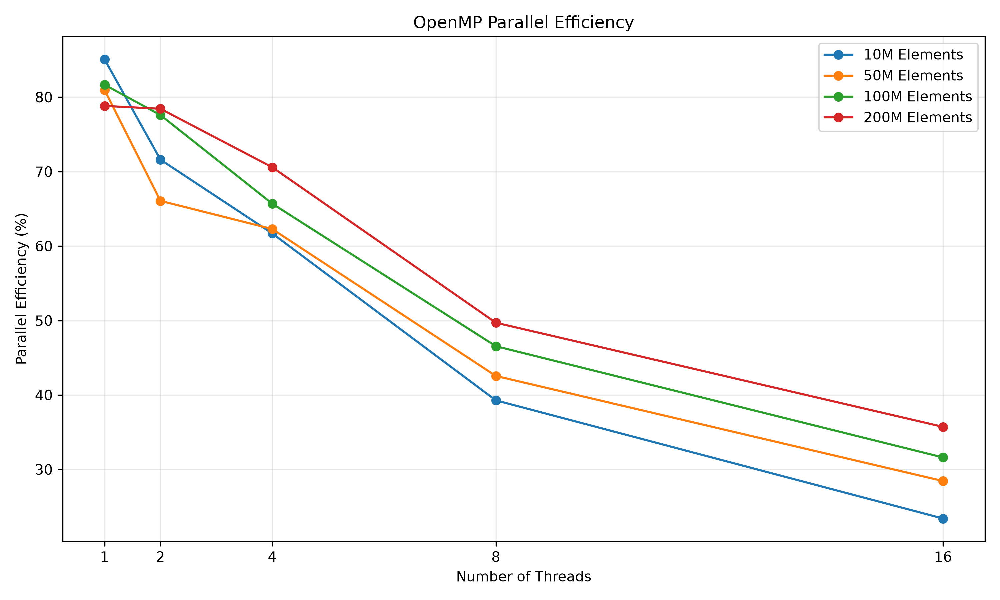
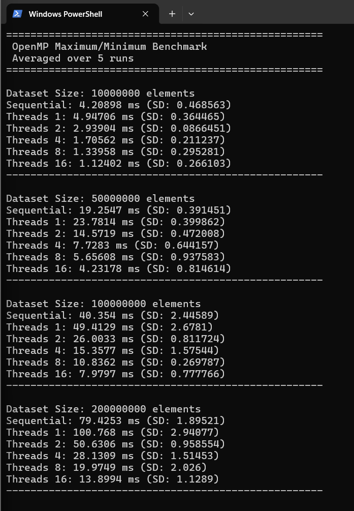

# Parallel Maximum/Minimum Search using OpenMP

> A parallel computing performance evaluation study comparing sequential and OpenMP-based maximum/minimum search algorithms across integer datasets ranging from 10 million to 200 million elements.

**Best Result:** **5.71× speedup** on 200M elements using 16 OpenMP threads (execution time reduced from 79.43 ms to 13.90 ms).

[](#technologies-used)
[](#technologies-used)
[](#system-configuration)
[](#overview)

---

## Table of Contents

- [Overview](#overview)
- [Problem Statement](#problem-statement)
- [Objectives](#objectives)
- [Technologies Used](#technologies-used)
- [System Configuration](#system-configuration)
- [Algorithm](#algorithm)
- [Parallelization Strategy](#parallelization-strategy)
- [Complexity Analysis](#complexity-analysis)
- [Experimental Methodology](#experimental-methodology)
- [Benchmark Results](#benchmark-results)
  - [Execution Time Summary](#execution-time-summary)
  - [Speedup Analysis](#speedup-analysis)
  - [Parallel Efficiency Analysis](#parallel-efficiency-analysis)
- [Performance Graphs](#performance-graphs)
- [Key Observations](#key-observations)
- [Correctness Verification](#correctness-verification)
- [Project Structure](#project-structure)
- [How to Build](#how-to-build)
- [How to Run](#how-to-run)
- [Generate Graphs](#generate-graphs)
- [Sample Output](#sample-output)
- [Screenshots](#screenshots)
- [Conclusion](#conclusion)
- [Future Improvements](#future-improvements)
- [Author](#author)

---

## Overview

Finding extreme values (the maximum and minimum) in large datasets is a fundamental computational task in data analysis, numerical computing, and database management. As dataset sizes scale to hundreds of millions of elements, traditional sequential search algorithms become bound by memory hierarchy and CPU execution latency.

This project investigates the performance, scalability, and parallel efficiency of multi-threaded maximum and minimum search using **OpenMP** compared against a baseline sequential implementation. The evaluation tests datasets containing up to **200,000,000 integers** across thread counts ranging from **1 to 16 threads**, capturing execution timing, standard deviations over repeated trials, speedup, and parallel efficiency.

---

## Problem Statement

Given a large array or contiguous buffer of $N$ randomly generated 32-bit integers, determine the global maximum value and the global minimum value efficiently.

The study compares:
1. **Sequential Execution:** A single-threaded linear scan evaluating both boundaries sequentially.
2. **OpenMP Parallel Execution:** Multi-threaded parallel execution utilizing OpenMP loop work-sharing with simultaneous reduction clauses for maximum and minimum values.

---

## Objectives

- Implement an optimized baseline sequential maximum/minimum search algorithm in C++.
- Implement a multi-threaded parallel maximum/minimum search algorithm using OpenMP loop work-sharing and reductions.
- Experiment across varying thread counts ($1, 2, 4, 8, 16$) to evaluate multicore scalability.
- Evaluate execution times across progressive dataset scales ($10\text{M}, 50\text{M}, 100\text{M}, 200\text{M}$ integers).
- Measure and analyze **speedup** achieved through parallelization.
- Measure and analyze **parallel efficiency** as thread counts increase.
- Calculate and report standard deviation across 5 consecutive benchmark runs per configuration to verify statistical stability.
- Generate comparative publication-grade visualization graphs from benchmark CSV data.

---

## Technologies Used

- **C++ (C++17 / C++11):** Core language for high-performance sequential and parallel implementations.
- **OpenMP:** Shared-memory multiprocessing API for multi-threaded work distribution and reductions.
- **GCC / MinGW g++:** Compiler supporting `-fopenmp` on Windows.
- **Python 3:** Data analysis and graph plotting.
- **Matplotlib:** Visualization library for rendering scaling, speedup, and efficiency graphs.
- **Windows / PowerShell:** Host operating system and execution environment.

---

## System Configuration

All benchmarks were evaluated under identical system conditions on the host machine:

| Component | Specification |
| :--- | :--- |
| **Processor** | 13th Gen Intel(R) Core(TM) i5-13450HX |
| **Physical Cores** | 10 Cores (6 Performance-cores + 4 Efficient-cores) |
| **Logical Processors** | 16 Threads |
| **System Memory (RAM)** | 16.0 GB DDR5 |
| **Operating System** | Windows 11 (64-bit) |
| **Compiler** | MinGW-w64 `g++` with `-fopenmp -O2` / `-O3` support |
| **Evaluated Thread Counts** | 1, 2, 4, 8, 16 threads |

> *Note: This study evaluates CPU shared-memory parallelism using OpenMP; GPU acceleration is not employed.*

---

## Algorithm

### 1. Sequential Algorithm
The sequential algorithm initializes `maxValue` to `INT_MIN` and `minValue` to `INT_MAX`. It performs a single linear pass over the dataset of size $N$, comparing each element against the current extremes and updating them sequentially.

```cpp
int maxValue = INT_MIN;
int minValue = INT_MAX;

for (long long i = 0; i < N; i++) {
    if (data[i] > maxValue) maxValue = data[i];
    if (data[i] < minValue) minValue = data[i];
}
```

### 2. OpenMP Parallel Algorithm
In a naive multithreaded design, updating shared `maxValue` and `minValue` variables inside parallel loops would trigger critical race conditions or require expensive mutex/critical sections that serialize memory access.

OpenMP eliminates this contention via reduction clauses:
```cpp
#pragma omp parallel for reduction(max:maxValue) reduction(min:minValue)
for (long long i = 0; i < N; i++) {
    if (data[i] > maxValue) maxValue = data[i];
    if (data[i] < minValue) minValue = data[i];
}
```

### 3. OpenMP Reduction Mechanism
- **Thread-Private Variables:** OpenMP automatically allocates a thread-private copy of `maxValue` (initialized to `INT_MIN`) and `minValue` (initialized to `INT_MAX`) for each participating thread.
- **Lock-Free Local Computation:** Each thread computes the local maximum and minimum on its assigned slice of the array completely independently, eliminating thread contention and false sharing during the main loop.
- **Reduction Combination:** At the conclusion of the parallel region, OpenMP combines the private values across threads into the global master variables using an efficient tree-reduction mechanism.

---

## Parallelization Strategy

The dataset is partitioned evenly across the available OpenMP threads using static chunk scheduling by default:

```
                      Input Dataset (N Elements)
                                  │
         ┌────────────────────────┼────────────────────────┐
         ▼                        ▼                        ▼
     Thread 0                 Thread 1                 Thread (P-1)
 [0 ... N/P - 1]         [N/P ... 2N/P - 1]      [(P-1)N/P ... N-1]
         │                        │                        │
  Local Scan:              Local Scan:              Local Scan:
   max0, min0               max1, min1               max(P-1), min(P-1)
         │                        │                        │
         └────────────────────────┼────────────────────────┘
                                  ▼
                       OpenMP Reduction Tree
            max = max(max0, max1, ..., maxP-1)
            min = min(min0, min1, ..., minP-1)
                                  ▼
                      Global Maximum & Minimum
```

---

## Complexity Analysis

| Metric | Sequential Search | OpenMP Parallel Search ($P$ Threads) |
| :--- | :--- | :--- |
| **Time Complexity** | $O(N)$ | $\mathcal{O}\left(\frac{N}{P}\right) + \mathcal{O}(\log P) + \mathcal{O}(\text{overhead})$ |
| **Space Complexity** | $O(1)$ auxiliary ($O(N)$ dataset) | $\mathcal{O}(P)$ private storage ($O(N)$ dataset) |

- **Computational Work:** Each thread performs $\approx \frac{N}{P}$ element comparisons.
- **Reduction Overhead:** Combining thread-local extremes incurs a logarithmic reduction step $\mathcal{O}(\log P)$.
- **Real-World Considerations:** Theoretical linear speedup ($P\times$) is not achieved in practice because memory-bound memory-read operations (DDR bandwidth saturation), thread startup/synchronization overhead, and CPU cache topology impose upper bounds.

---

## Experimental Methodology

- **Dataset Sizes Tested:**
  - $10,000,000$ elements ($\approx 38.1$ MB)
  - $50,000,000$ elements ($\approx 190.7$ MB)
  - $100,000,000$ elements ($\approx 381.5$ MB)
  - $200,000,000$ elements ($\approx 762.9$ MB)
- **Thread Counts Tested:** $1, 2, 4, 8, 16$ threads.
- **Benchmarking Protocol:**
  - Each configuration was executed over **5 independent runs**.
  - Execution times were recorded using `std::chrono::high_resolution_clock`.
  - Both **Average Execution Time (Mean)** and **Standard Deviation (SD)** were calculated.
- **Isolation of Measurement:**
  - Memory allocation and random data population (`std::mt19937`) are completed before starting timers.
  - Timing strictly measures the search iteration phase and excludes dataset generation.

---

## Benchmark Results

### Execution Time Summary

The following table reports the observed mean execution times (in milliseconds) and standard deviations across 5 runs for each workload:

| Dataset Size | Sequential (ms) | 1 Thread (ms) | 2 Threads (ms) | 4 Threads (ms) | 8 Threads (ms) | 16 Threads (ms) |
| :---: | :---: | :---: | :---: | :---: | :---: | :---: |
| **10,000,000** | 4.2090 $\pm$ 0.469 | 4.9471 $\pm$ 0.364 | 2.9390 $\pm$ 0.087 | 1.7056 $\pm$ 0.211 | 1.3396 $\pm$ 0.295 | **1.1240 $\pm$ 0.266** |
| **50,000,000** | 19.2547 $\pm$ 0.391 | 23.7814 $\pm$ 0.400 | 14.5719 $\pm$ 0.472 | 7.7283 $\pm$ 0.644 | 5.6561 $\pm$ 0.938 | **4.2318 $\pm$ 0.815** |
| **100,000,000** | 40.3540 $\pm$ 2.446 | 49.4129 $\pm$ 2.678 | 26.0033 $\pm$ 0.812 | 15.3577 $\pm$ 1.575 | 10.8362 $\pm$ 0.270 | **7.9797 $\pm$ 0.778** |
| **200,000,000** | 79.4253 $\pm$ 1.895 | 100.7680 $\pm$ 2.941 | 50.6306 $\pm$ 0.959 | 28.1309 $\pm$ 1.515 | 19.9749 $\pm$ 2.026 | **13.8994 $\pm$ 1.129** |

---

### Speedup Analysis

Speedup is defined as:
$$\text{Speedup}(P) = \frac{T_{\text{Sequential}}}{T_{\text{Parallel}}(P)}$$

| Dataset Size | 1 Thread | 2 Threads | 4 Threads | 8 Threads | 16 Threads |
| :---: | :---: | :---: | :---: | :---: | :---: |
| **10M Elements** | 0.85× | 1.43× | 2.47× | 3.14× | **3.74×** |
| **50M Elements** | 0.81× | 1.32× | 2.49× | 3.40× | **4.55×** |
| **100M Elements** | 0.82× | 1.55× | 2.63× | 3.72× | **5.06×** |
| **200M Elements** | 0.79× | 1.57× | 2.82× | 3.98× | **5.71×** |

> **Key Milestone:** The highest performance was achieved on the **200M dataset with 16 threads**, reducing runtime from **79.4253 ms down to 13.8994 ms**, yielding an effective speedup of **~5.71×**.

---

### Parallel Efficiency Analysis

Parallel efficiency measures how effectively additional compute cores are utilized:
$$\text{Efficiency}(P) = \frac{\text{Speedup}(P)}{P} \times 100\%$$

| Dataset Size | 1 Thread | 2 Threads | 4 Threads | 8 Threads | 16 Threads |
| :---: | :---: | :---: | :---: | :---: | :---: |
| **10M Elements** | 85.08% | 71.60% | 61.69% | 39.28% | 23.40% |
| **50M Elements** | 80.97% | 66.07% | 62.29% | 42.55% | 28.44% |
| **100M Elements** | 81.67% | 77.59% | 65.69% | 46.55% | 31.61% |
| **200M Elements** | 78.82% | 78.44% | 70.59% | 49.70% | **35.71%** |

---

## Performance Graphs

All graphs were rendered directly from the validated benchmark CSV data using Matplotlib.

### 1. Execution Time vs Dataset Size
Shows the linear execution time scaling across data volumes for sequential and parallel configurations.



---

### 2. Thread Scaling
Demonstrates execution time reduction as thread counts increase from 1 to 16 for all dataset sizes.



---

### 3. Speedup vs Number of Threads
Visualizes speedup gains across thread counts, demonstrating superior scalability for larger problem sizes.



---

### 4. Parallel Efficiency
Illustrates the decline in parallel efficiency as thread counts increase due to memory bus saturation and OpenMP synchronization costs.



---

## Key Observations

1. **Increasing Benefits with Scale:** OpenMP parallelization achieves higher speedups as problem sizes increase (from 3.74× on 10M elements up to 5.71× on 200M elements at 16 threads). Larger workloads allow computation to dominate parallel runtime overhead.
2. **Single-Thread Overhead:** A single OpenMP thread ($P=1$) ran slightly slower than the pure sequential baseline (speedup $\approx 0.79\times - 0.85\times$). This is caused by OpenMP runtime framework initialization, reduction bookkeeping, and thread team management overhead.
3. **Sub-Linear Speedup:** While 16 threads yielded up to 5.71× speedup, speedup is sub-linear rather than theoretical 16×. Max/min search has a high memory-to-computation ratio ($\mathcal{O}(1)$ operations per element read), making the workload predominantly **memory-bandwidth limited** as multiple cores simultaneously saturate DDR memory channels.
4. **Architectural Heterogeneity:** On the test processor (Intel Core i5-13450HX), physical cores consist of 6 Performance cores (P-cores) and 4 Efficient cores (E-cores). Scaling from 8 to 16 logical threads distributes work across hyperthreads and E-cores, which have differing execution throughput compared to primary P-cores.
5. **Statistical Stability:** Standard deviations across all 5 runs remained consistently low (e.g., $\le 1.13\text{ ms}$ on 200M at 16 threads), confirming reliable execution characteristics.

---

## Correctness Verification

To guarantee that parallel reduction preserves computational accuracy, the benchmark compares the sequential output against parallel output for every configuration:

- Dataset generated using uniform distribution: $[1, 1000000]$ with fixed seed (`mt19937(42)`).
- Sequential calculation: `Maximum = 1,000,000`, `Minimum = 1`.
- OpenMP multi-thread calculation ($1, 2, 4, 8, 16$ threads): `Maximum = 1,000,000`, `Minimum = 1`.
- **Outcome:** Exact agreement across all runs with zero variance in extreme values, confirming race-free reduction execution.

---

## Project Structure

```
Parallel-Max-Min-OpenMP/
│
├── src/
│   ├── sequential.cpp          # Baseline single-threaded max/min implementation
│   ├── openmp.cpp              # OpenMP multi-threaded implementation
│   └── benchmark.cpp           # Automated benchmark harness (multi-size, multi-thread, 5 runs)
│
├── results/
│   └── benchmark.csv           # Measured timings, standard deviations, and results
│
├── graphs/
│   ├── execution_time_vs_dataset.png  # Execution time vs dataset size plot
│   ├── thread_scaling.png             # Execution time vs thread count plot
│   ├── speedup_vs_threads.png         # Speedup curve across thread configurations
│   └── parallel_efficiency.png        # Parallel efficiency percentage plot
│
├── screenshots/
│   └── benchmark_results.png   # Terminal capture of benchmark execution
│
├── scripts/
│   └── plot_results.py         # Python visualization script generating all 4 figures
│
├── README.md                   # Complete project documentation and analysis
└── .gitignore                  # Git ignore rules for build artifacts and caches
```

---

## How to Build

Compile all source programs using `g++` via Windows PowerShell:

```powershell
# Compile sequential implementation
g++ src/sequential.cpp -o sequential.exe

# Compile OpenMP parallel implementation
g++ -fopenmp src/openmp.cpp -o openmp.exe

# Compile benchmark harness
g++ -fopenmp src/benchmark.cpp -o benchmark.exe
```

---

## How to Run

Execute the compiled programs directly:

```powershell
# Run the sequential standalone search (10M elements)
.\sequential.exe

# Run the OpenMP standalone search (10M elements)
.\openmp.exe

# Run the full benchmark suite across all dataset sizes and thread counts
.\benchmark.exe
```

The benchmark program writes complete metrics directly to `results/benchmark.csv`.

---

## Generate Graphs

Regenerate all four high-resolution performance plots using Python:

```powershell
python scripts/plot_results.py
```

The plots are automatically saved in the `graphs/` directory.

---

## Sample Output

Snippet of terminal output from the benchmark program:

```text
====================================================
 OpenMP Maximum/Minimum Benchmark
 Averaged over 5 runs
====================================================

Dataset Size: 10000000 elements
Sequential: 4.20898 ms (SD: 0.468563)
Threads 1: 4.94706 ms (SD: 0.364465)
Threads 2: 2.93904 ms (SD: 0.0866451)
Threads 4: 1.70562 ms (SD: 0.211237)
Threads 8: 1.33958 ms (SD: 0.295281)
Threads 16: 1.12402 ms (SD: 0.266103)
----------------------------------------------------

Dataset Size: 200000000 elements
Sequential: 79.4253 ms (SD: 1.89521)
Threads 1: 100.768 ms (SD: 2.94077)
Threads 2: 50.6306 ms (SD: 0.958554)
Threads 4: 28.1309 ms (SD: 1.51453)
Threads 8: 19.9749 ms (SD: 2.026)
Threads 16: 13.8994 ms (SD: 1.1289)
----------------------------------------------------

====================================================
 Benchmark completed successfully.
 Results saved to: results\benchmark.csv
====================================================
```

---

## Screenshots

Terminal screenshot verifying the benchmark output over 5 runs across all 4 dataset sizes and 5 thread counts:



---

## Conclusion

This evaluation demonstrates the effectiveness and real-world limits of shared-memory parallel programming using OpenMP:
- OpenMP loop work-sharing combined with reduction clauses provides a race-free, syntactically clean mechanism to parallelize extreme-value search algorithms.
- Across large datasets (up to 200M elements), parallelization reduced search time from **79.43 ms down to 13.90 ms**, delivering a **5.71× speedup**.
- Because maximum/minimum search performs minimal arithmetic operations per element read, real-world scaling is constrained by memory bandwidth rather than compute limits, preventing ideal linear $16\times$ speedup.
- As problem size expands, parallel efficiency improves significantly, proving that OpenMP delivers substantial performance improvements for memory-intensive data scans on modern multicore systems.

---

## Future Improvements

- **Larger Datasets:** Evaluate scaling beyond 200 million elements (up to several gigabytes) to further assess memory bandwidth limits.
- **CPU Affinity & Pinning:** Test thread binding policies (`OMP_PROC_BIND` and `OMP_PLACES`) to evaluate the impact of cache locality and core migration.
- **Scheduling Strategies:** Compare `schedule(static)`, `schedule(dynamic)`, and `schedule(guided)` on datasets with skewed or irregular value distributions.
- **Heterogeneous Core Analysis:** Benchmark performance when binding threads strictly to Performance-cores versus Efficient-cores.
- **Comparison with Alternative Paradigms:** Benchmark OpenMP against SIMD vectorization (AVX-512 / AVX2), CUDA (GPU), and MPI (distributed memory).

---

## Author

**PGC Parallel Computing Project**
